# Mangas: convertirlos para leer en Kindle

:material-account: MKL · :material-link-variant: [Ver el original en Telegraph](https://telegra.ph/Tutorial-para-convertir-Manga-para-Kindle-06-14){ target=_blank }
{ .tut-datos }

---

 

El proceso es muy simple y en realidad basta con unos programas y webs:

- **Free Manga Downloader:** este programa sirve para buscar en páginas web de scalations los mangas a descargar. Este es opcional porque también puede servir que lo descargues manualmente uno por uno, aunque es algo tedioso. [https://mega.nz/#!PNFzGCpa!K\_l0h4RWn57k-nCMYor8tzDZgVCUCV-yS58adqeOES8](https://mega.nz/#!PNFzGCpa!K_l0h4RWn57k-nCMYor8tzDZgVCUCV-yS58adqeOES8)
- ** Hanuneko:** este programa sirve para buscar en páginas web de scalations los mangas a descargar. [https://hakuneko.download/](https://hakuneko.download/)
- **Kindle Comic Converter**: este es el programa realmente necesario que transformará las imágenes descargadas de los mangas en un formato que pueda leer el lector de libros electrónicos, como el MOBI.                                     [https://kcc.iosphe.re/](https://kcc.iosphe.re/)
- **Kindlegen: **[https://drive.google.com/file/d/1lnmcrwG4\_Mu03kI9NZ51\_TvAudOYpA0O/view?usp=sharing](https://drive.google.com/file/d/1lnmcrwG4_Mu03kI9NZ51_TvAudOYpA0O/view?usp=sharing)
- **7Zip:** [https://www.7-zip.org/download.html](https://www.7-zip.org/download.html)
- **Calibre: **este programa sirve para tener una biblioteca perfectamente ordenada y además con sincronización con nuestro lector de libros. Es opcional, pero como usuarios de Kindle es normal que ya lo tengan instalado. [https://calibre-ebook.com/](https://calibre-ebook.com/)
- Pagina para descargar manga en CBZ: [https://www.mar9celo3.com/](https://www.mar9celo3.com/)

## Configuración

1) Una vez descargado y descomprimido no hay que instalar nada, solo mover la carpeta donde quieren tener el programa y crear un acceso directo por si quieren tenerlo más a la mano. Una vez hecho entramos en la carpeta y ejecutamos el .exe que se llama fmd.

Ya abierto, hay que saber que el programa está configurado para buscar en sitios webs en inglés, por lo tanto si queremos manga en español, primero hay que configurarlo.

Para ello nos vamos a Opciones y a Sitios Web y marcamos las páginas en español que queramos, por ejemplo Tumangaonline o NinemangaES. También tiene un apartado para descargar directamente de los fansubs. Le damos a aceptar y listo.

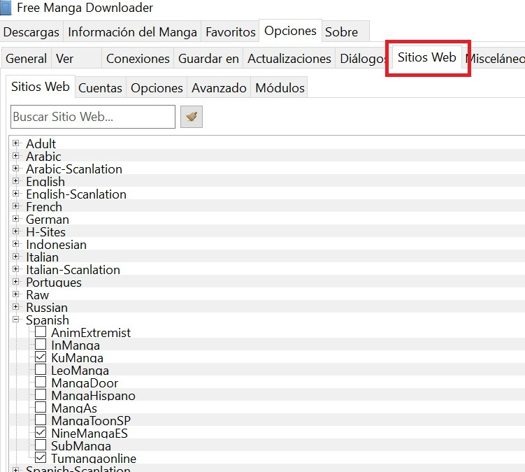

##  

## Descarga de Manga

A continuación nos vamos a Manga Info seleccionamos la fuente que dimos en el paso anterior, el programa hará una breve descarga y nos aparecerá el listado de manga. Buscamos el que queramos, marcamos los capítulos y simplemente le damos a Download.

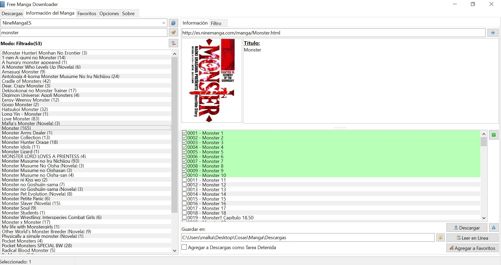

O pueden ir directo a las paginas oficiales o redes sociales de los distintos Fansub. Hay muchos que tienen sus enlaces directo a mega o mediafire.

O la la web de Marcelo: [https://www.mar9celo3.com/](https://www.mar9celo3.com/)

## Maquetación de Manga

2) Una vez descargado el manga, tendremos las imágenes descargadas y numeradas listas para su conversión mediante KCC. Pero antes, **sugiero**:

-Poner la portada del tomo en el primer capitulo del volumen correspondiente como archivo "000.jpg" o "001.jpg o png"

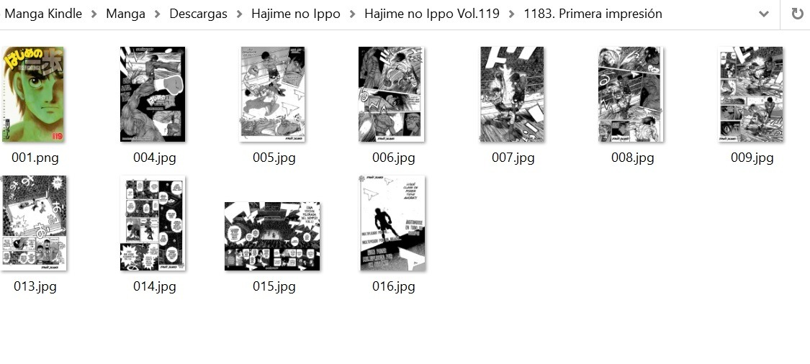

-Eliminar las imágenes que no aportan mucho como las innecesarias publicidades de los scans o imágenes coloreadas de manera "amateur". Esto es para mejorar la experiencia de la lectura y no tener distracciones. Si, se que esto puede ser algo "polémico" pero realmente que dichas publicidades no aportan en nada y pueden estropear la estructura de los capítulos.

-Ordenar y nombrar cada capítulo con su número correspondiente y título (es muy "tikismikis" y da pereza pero queda genial).

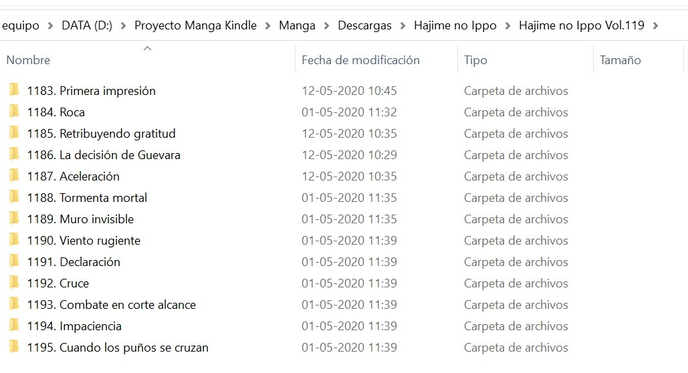

 

-Comprimir las carpetas de los capítulos correspondientes al volumen, por ejemplo: Hajime no Ippo Volumen 119 va del capítulo 1183 al 1195 en .zip y luego cambiarle el formato a .CBZ. Esto es para poder **incluir algunos metadatos en KCC como el nombre del autor** y ademas **crear un "indice de capítulos" dentro del mobi** (para esto yo renombro cada carpeta como "1183. Primera impresión".

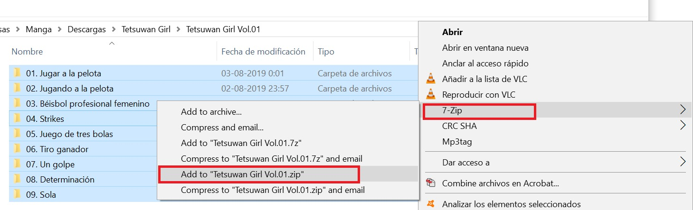

 

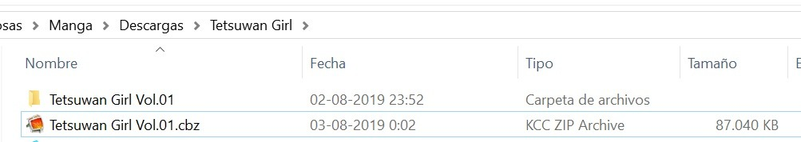

Ahora instalamos KCC, y una vez hecho, veremos que el programa nos alerta que si queremos crear archivos MOBI (uno de los formatos que usa el Kindle) \*\*IMPORTANTE\*\* Una vez instalado KCC, hay que poner el archivo llamado kindlegen dentro del directorio del programa.

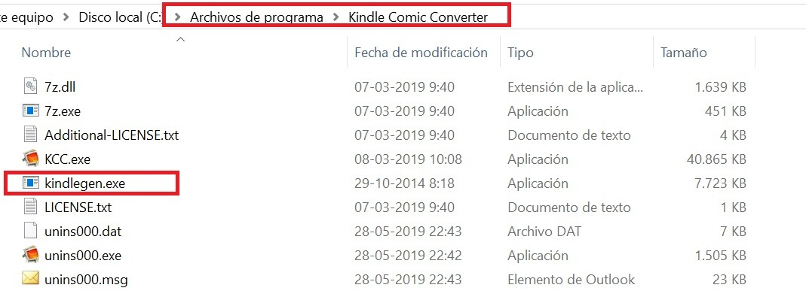

 

El resto es muy sencillo, le damos a Add Directory, seleccionamos la carpeta donde hemos descargado el manga, seleccionamos el dispositivo que tengamos, el formato, en este caso MOBI/AZW3 y hacemos clic en Manga mode, Stretch/upscale, en Spread Splitter **(esto es para dejar las imágenes en pantalla completa y no con grandes margenes como lo hace calibre).**  Y en Color Mode para conservar el color de la portada al momento de verla en Calibre.

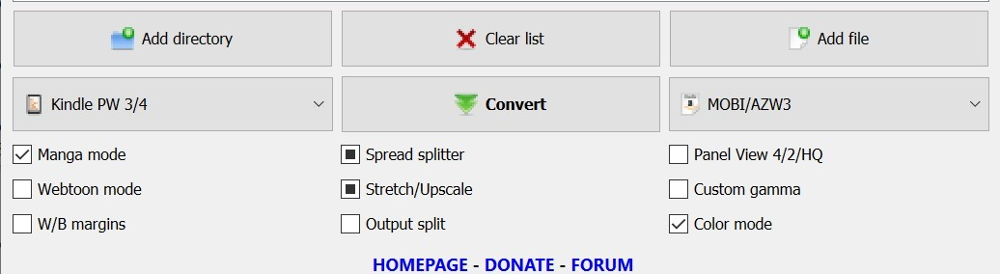

 

Luego nos vamos a "Editor", seleccionamos el archivo CBZ y podrás incluir el nombre completo del archivo, por ejemplo: Hajime no Ippo. En Volumen ponemos el numero de volumen correspondiente, por ejemplo 01, 21, 30, etc **\*\*Recomiendo poner un cero a de los volúmenes 1 a 9 (01, 02, 08, 09), para que así no haya problemas de orden luego de los volumenes 10 en adelante\*\***   y su Autor: como por ejemplo, George Morikawa. Number solo aplica para capítulos sueltos, no volúmenes completos.

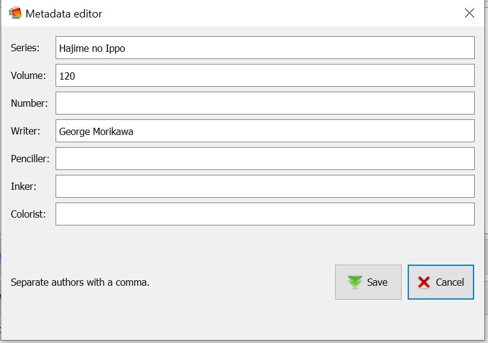

 

Ya solo nos queda darle a save y luego a  Convert.

3) Pasar el archivo mobi al Kindle:

Esto se puede hacer mediante usb directo y dejar el archivo en la carpeta "Documents" de Kindle pero al hacer esto no se visualizará la portada de los volumenes.

**Calibre**

Este es el último programa y es opcional también, ya que siempre podemos meter el MOBI resultante del apartado anterior directamente en el Kindle, pero así podemos tener una Biblioteca perfectamente ordenada.

Una vez instalado y abierto el programa, es tan sencillo como hacer clic en Añadir Libros para añadir el libro a la Biblioteca, a continuación si queremos podemos Modificar los metadatos para añadir datos como el género, ejemplo: Acción, Shonen.

Seguidamente conectamos el Kindle al ordenador, esperamos que el Calibre lo detecte, seleccionamos el libro y le damos a Enviar al dispositivo que teniendo en cuenta el tamaño tardará un poco y ya tenemos el manga en el Kindle.

Resultados finales:

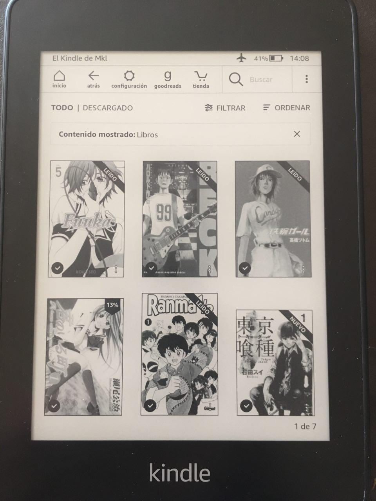  
<small>Portadas de cada volumen</small>

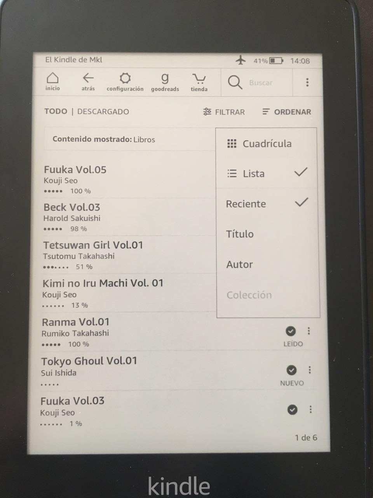  
<small>Nombre del archivo como volumen + Nombre del autor y no "KCC"</small>

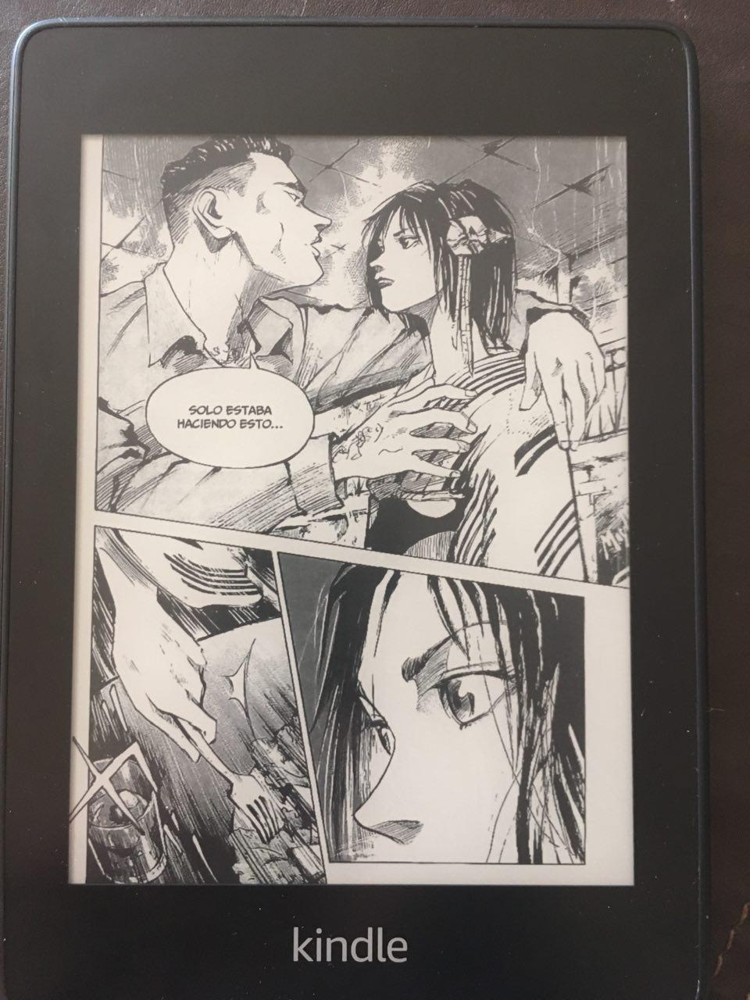  
<small>Cada pagina se ve en pantalla completa y no como la versión que deja la conversión a mobi de Calibre</small>

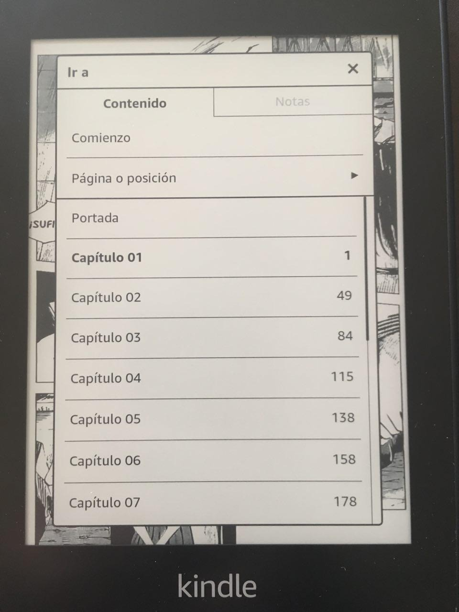  
<small>Índice de capítulos generado por tener cada capitulo en distintas carpetas nombradas como "Capítulo 01" o "166. Regresando a casa"  ---\> número de capitulo + el título, esta nomenclatura es la que más me gusta.</small>

 

---

[:material-arrow-left: Volver al índice](../../alfabetico.md) · [:fontawesome-brands-telegram: Preguntar en el grupo](https://t.me/calibreconfiguraciones){ target=_blank }
