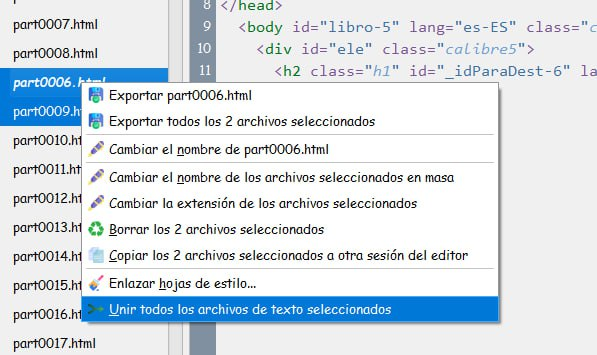
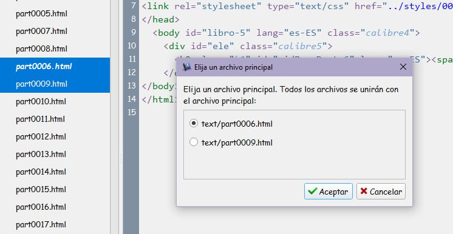
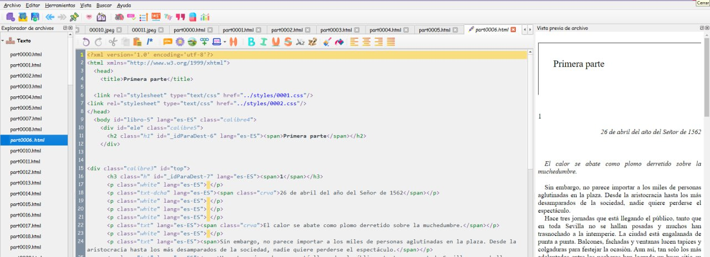

# Unir dos páginas HTML

:material-account: [Walter](https://t.me/Dunhill69){ target=_blank } · :material-link-variant: [Ver el original en Telegraph](https://telegra.ph/Unir-dos-p%C3%A1ginas-html-02-03){ target=_blank }
{ .tut-datos }

---

Explicado por @jane\_morris

Pero vamos a obviar eso, para que te enseñe un método de unir dos páginas sin que tengas que hacer todo eso. En este caso hay que correr la página del capítulo 1 hasta dejarla justo debajo de la página donde pone Primeraparte, para eso sujetas con el boton izqdo del raton justo encima del html del capítulo 1 y sin soltarlo lo arrastras hacia arriba hasta dejarlo inmediatamente debajo del html que pone primera parte

ves? el html 0006 es el de primera parte y el html 0009 es el del capitulo 1, movidos de tal forma que queden seguiditos, (esto normalmente como no habrá mapas por medio no lo tendras que hacer, ya los tendras seguidos)

marcas el 0006, luego pulsas ctrl y marcas el 0009, así te quedan seleccionados los dos ,tal que así

Ahora situada encima de los dos marcados en azul pulsas el botón derecho y eliges la opción.

Te aparecerá esta ventanita

en la que ves que te dice que todos los archivos se unirán con el principal que es el primero, así el primero te queda arriba directamente en este caso el de primera parte. Aceptas

Y voilà te aparecen los dos archivos unidos con la primera parte arriba que es como lo quieres tú

 

Ir al mensaje: [https://t.me/calibreconfiguraciones/144967/145423](https://t.me/calibreconfiguraciones/144967/145423)

## [Volver al inicio](https://telegra.ph/Indice-Calibre-en-Espa%C3%B1ol-10-03)

 

---

[:material-arrow-left: Volver al índice](../../alfabetico.md) · [:fontawesome-brands-telegram: Preguntar en el grupo](https://t.me/calibreconfiguraciones){ target=_blank }
