# Unir una saga

:material-account: [Walter](https://t.me/Dunhill69){ target=_blank } · :material-link-variant: [Ver el original en Telegraph](https://telegra.ph/Unir-una-saga-09-12){ target=_blank }
{ .tut-datos }

---

Hoy me preguntaron como se podría unir una saga en un solo archivo epub.

Para esto existe un plugin EpubMerge.

Para instalarlo tocamos la flecha lateral del icono de preferencia y tocamos **Obtener complementos para mejorar el calibre**.

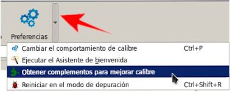

Se nos abre esta pantalla con el listado del todos los plugin y en el recuadro de filtrar por nombre ponemos Epubmurge, lo seleccionamos y le damos en instalar.

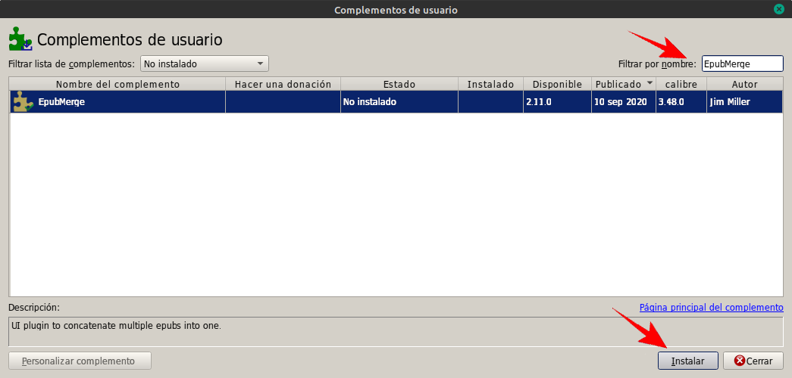

Le damos que si a las preguntas y le damos en aceptar en este recuadro, acá nos esta diciendo donde aparecerá el icono del plugin.

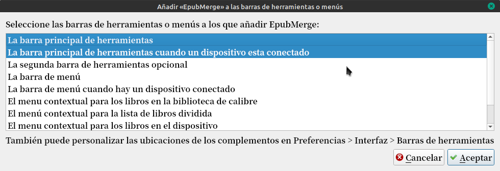

Nos va a pedir que reiniciemos Calibre.

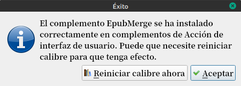

Así se ve el icono del plugin.

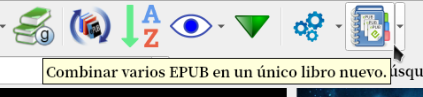

En mi caso voy a poner en un solo epub la saga del señor de los anillos.

Se supone que tenemos los libros con los metadatos completados, para poder hacer la búsqueda de la serie, la serie debe estar cargada.

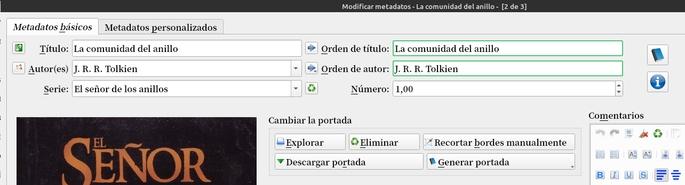

Entonces buscamos series:"El señor de los anillos"

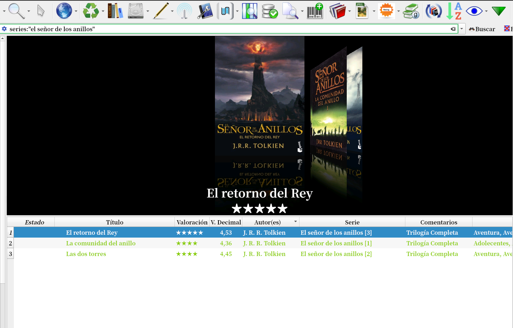

En la configuración del plugin están estas opciones para elegir a nuestro gusto.

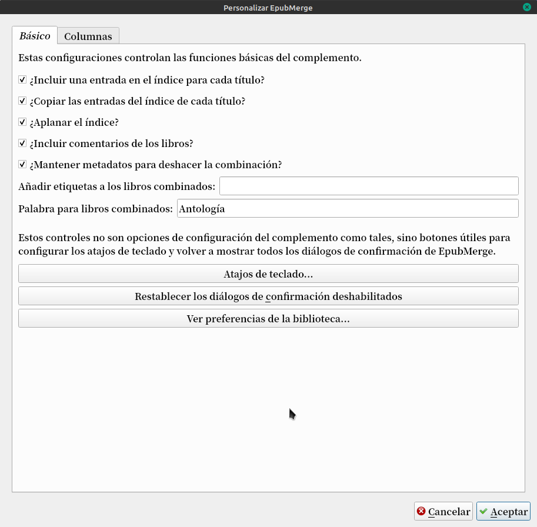

Con los libros seleccionados, tocamos la flecha del costado del plugin y tocamos en Combinar Epub.

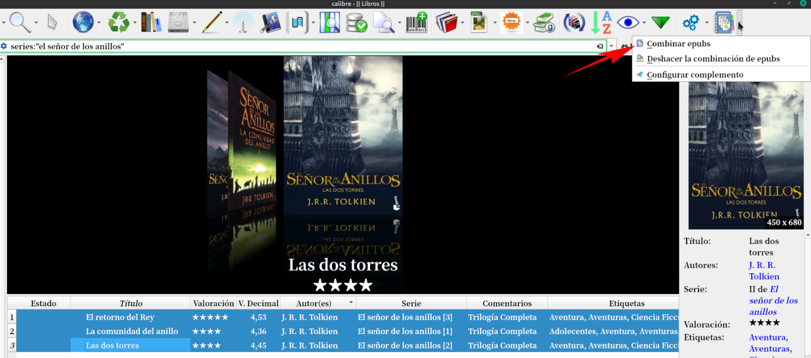

Rápidamente nos sale una pantalla donde podemos ordenar los libros por orden de serie. Seleccionado el libro y con las flechas verdes acomodamos.

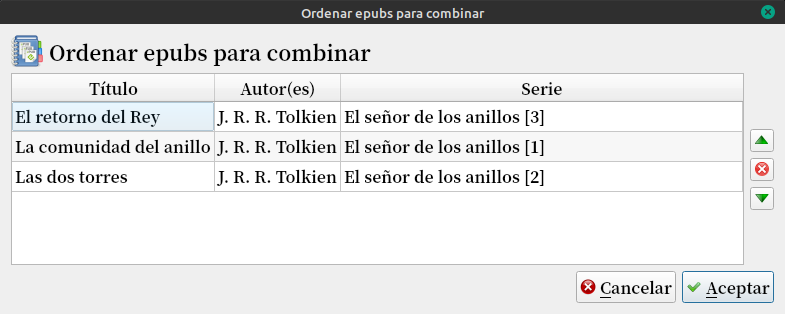

Una vez acomodado tocamos Aceptar.

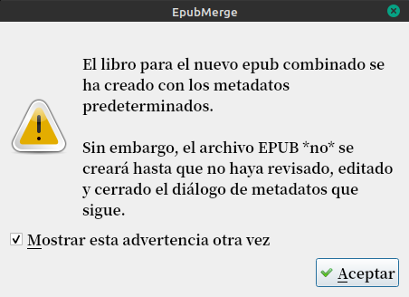

Yo al abrirse el editor de metadatos en el campo de serie lo edite poniendo Saga completa y en el numero 0

Después nos aparece este cartel de la compilación.

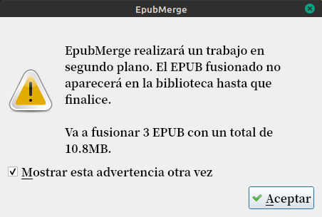

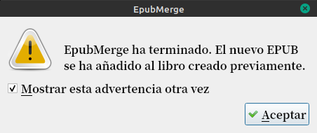

Y así vemos como queda cargado el epub con la saga completa del señor de los anillos para tener todos los libros en un solo archivo.

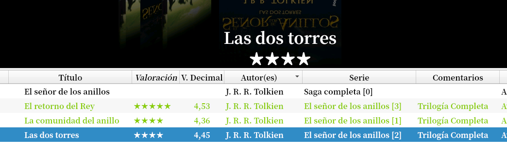

ir al mensaje: [https://t.me/calibreconfiguraciones/18219](https://t.me/calibreconfiguraciones/18219)

 

 

## [Volver al inicio](https://telegra.ph/Indice-Calibre-en-Espa%C3%B1ol-10-03)

 

 

 

---

[:material-arrow-left: Volver al índice](../../alfabetico.md) · [:fontawesome-brands-telegram: Preguntar en el grupo](https://t.me/calibreconfiguraciones){ target=_blank }
