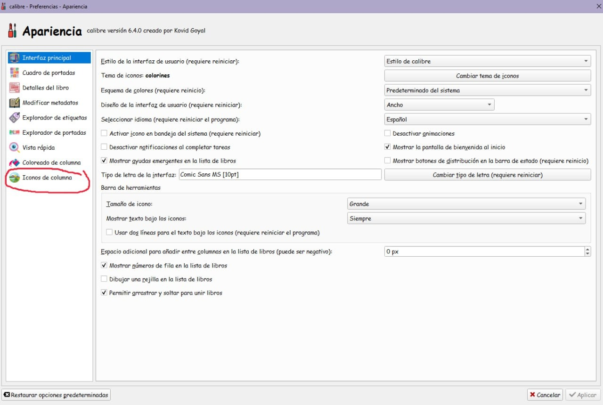
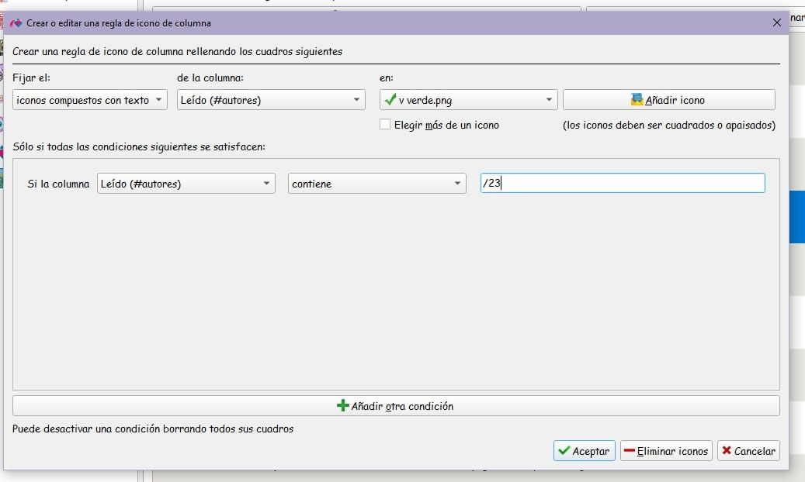
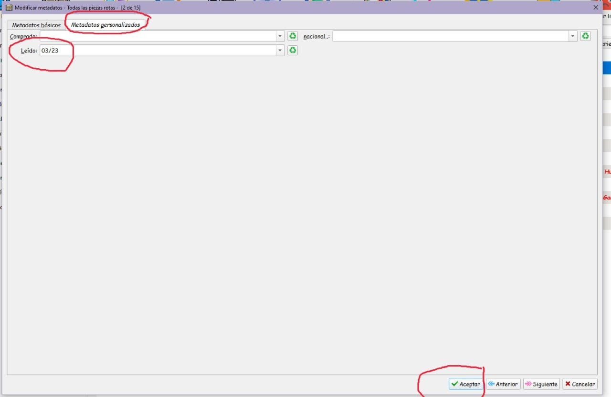
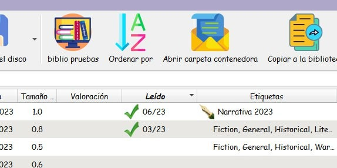

# Ícono verde de verificación (columna Leído)

:material-account: [Walter Paterno](https://t.me/Dunhill69){ target=_blank } · :material-link-variant: [Ver el original en Telegraph](https://telegra.ph/V-verde-verificaci%C3%B3n-en-columna-le%C3%ADdo-en-calibre-06-02-2){ target=_blank }
{ .tut-datos }

---

Explicado por @janes\_morris

01) P**referencias—\>apariencia—\>iconos de columna**

02) Clic en añadir regla.

03) Exacto que esto, y clic en añadir icono para traer la V verde de nuestro ordenador.

**04) Y ahora en los metadatos por separado, en la pestaña metadatos personalizados, así.**

05) Y ya nos aparece así en calibre.

Hay que guardarse previamente esta imagen en el ordenador para poder traerla en el paso 03).Descargar en este mismo formato, png, para que el fondo sea transparente.

Ir al mensaje: [https://t.me/calibreconfiguraciones/112333/136783](https://t.me/calibreconfiguraciones/112333/136783)

## [Volver al inicio](https://telegra.ph/Indice-Calibre-en-Espa%C3%B1ol-10-03)

 

 

 

 

 

---

[:material-arrow-left: Volver al índice](../../alfabetico.md) · [:fontawesome-brands-telegram: Preguntar en el grupo](https://t.me/calibreconfiguraciones){ target=_blank }
