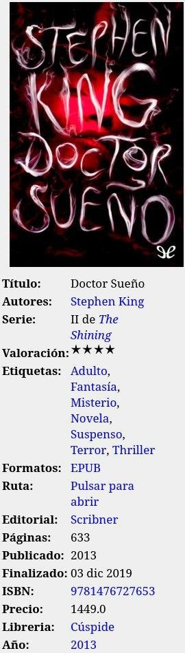
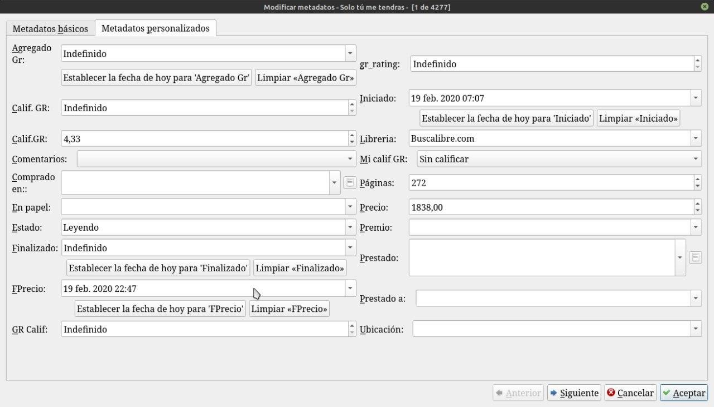
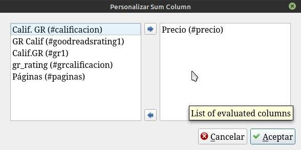
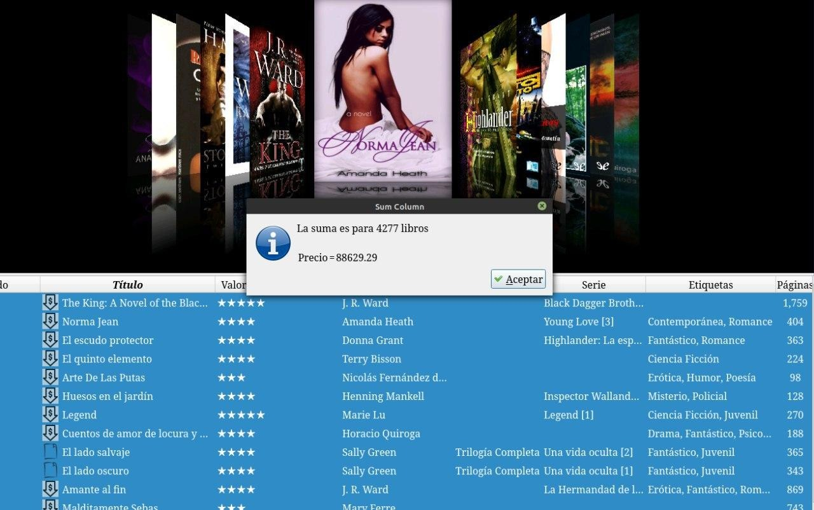

# Valorizar la biblioteca (saber cuánto gastamos en libros)

:material-account: [Walter](https://t.me/Dunhill69){ target=_blank } · :material-link-variant: [Ver el original en Telegraph](https://telegra.ph/Valorizar-Biblioteca-09-08){ target=_blank }
{ .tut-datos }

---

Les quería comentar que estaba con ganas de valorizar mi biblioteca de los libros que voy leyendo y completando la mayor cantidad de datos del libro posible y uno de ellos es el precio. Entonces se me ocurrió hacer una columna personalizada para el precio que lo descargo de varias paginas de librerías de mi país y otra columna para la fecha de ese precio. Otra para saber el origen de ese precio (llámese Librería o pagina de librería). Pero no podía obtener la suma de esta columna. Hasta que encontré un plugin que suma las columnas personalizadas.

Así se ve mi detalle del libro:

Así las columnas personalizadas del libro.

El plugin se llama suma columna y suma columnas personalizadas ir al plugin: [https://t.me/calibreconfiguraciones/7719](https://t.me/calibreconfiguraciones/7719)

Así configuramos el plugin, a la izquierda están nuestras columnas personalizadas y pasamos a la derecha la que nos interesa.

Y así vemos el valor de nuestra biblioteca.

ir al mensaje: [https://t.me/calibreconfiguraciones/7718](https://t.me/calibreconfiguraciones/7718)

[https://telegra.ph/Valorizar-Biblioteca-09-08](https://telegra.ph/Valorizar-Biblioteca-09-08)

 

 

## [Volver al inicio](https://telegra.ph/Indice-Calibre-en-Espa%C3%B1ol-10-03)

 

 

---

[:material-arrow-left: Volver al índice](../../alfabetico.md) · [:fontawesome-brands-telegram: Preguntar en el grupo](https://t.me/calibreconfiguraciones){ target=_blank }
