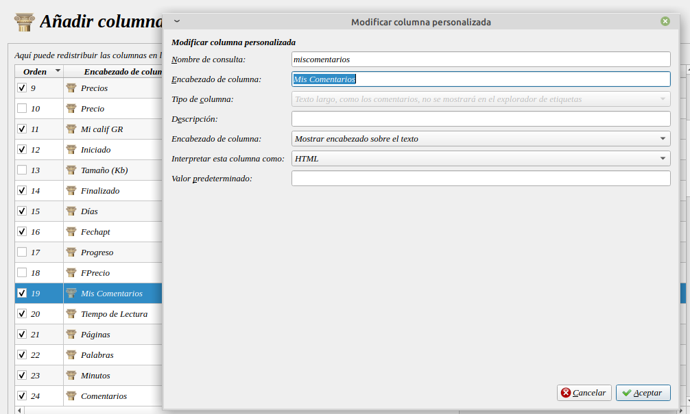
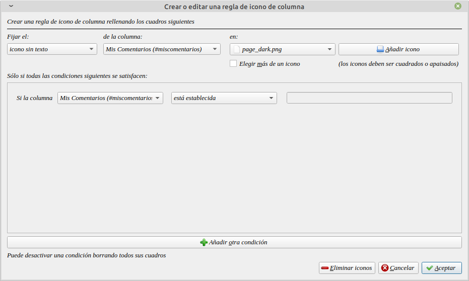
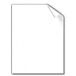
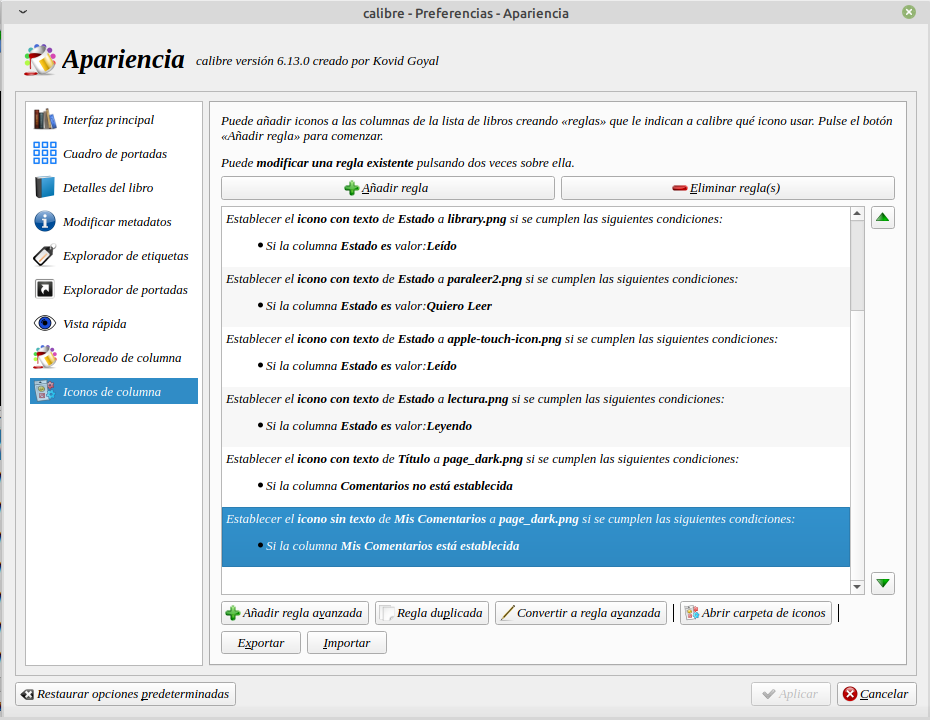
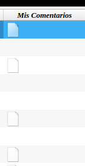
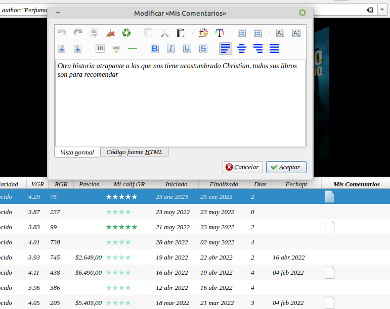
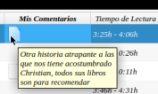

# Ventana emergente de comentarios en Calibre

:material-account: [Walter Paterno](https://t.me/Dunhill69){ target=_blank } · :material-link-variant: [Ver el original en Telegraph](https://telegra.ph/Ventana-Pop-up-en-Calibre-02-26){ target=_blank }
{ .tut-datos }

---

Hoy les voy a explicar un truco de como tener una ventana Pop-up para las columnas personales.

En mi caso lo aplique a mi columna de Comentarios sobre el libro.

Lo primero es crear una columna personalizada

Detalle de los campos a completar:

**Nombre de consulta:** nombreenminúsculasytodojunto

**Encabezado de columna:**

Nombre como lo veremos en la pantalla principal de Calibre.

**Tipo de columna: **

Elegir la opción:  "Texto largo, como comentarios, no aparecerá en el explorador de etiquetas".

**Encabezado de columna:**

Elegir la opción: "Mostrar encabezado sobre el texto"

**Interpretar esta columna como: **HTML

Le damos en **Aceptar**.

 

Una vez creada la columna podríamos generar una regla para poder visualizar que esa columna tiene un dato en ella.

Para eso vamos a Preferencia/Apariencia y tocamos el botón Añadir regla.

Lo que expresa la imagen es que se va a ver un icono sin texto, que se va a aplicar sobre la columna, en este caso "Mis comentarios" y con el botón Añadir icono, le asignamos una imagen.

Icono que he usado se los dejo a continuación o también la podrán encontrar en el apartado de recursos del grupo.

Una vez establecida la regla nos quedará así. Como la remarcada en azul.

Así se verá en la pantalla principal de nuestros Calibre, si nuestro campo de "Mis comentarios" tiene algo.

Y la magia viene, estando posicionados en la columna "Mis comentarios" si apretamos la combinación de teclas Fn+F2 aparecerá una ventana emergente con los datos cargados en ella.

O pasando el cursor del mouse aparecerá el texto.

Espero que les sea útil y que les haya gustado.

Ir al mensaje: [https://t.me/calibreconfiguraciones/112333/129703](https://t.me/calibreconfiguraciones/112333/129703)

 

## [Volver al inicio](https://telegra.ph/Indice-Calibre-en-Espa%C3%B1ol-10-03)

 

 

 

---

[:material-arrow-left: Volver al índice](../../alfabetico.md) · [:fontawesome-brands-telegram: Preguntar en el grupo](https://t.me/calibreconfiguraciones){ target=_blank }
