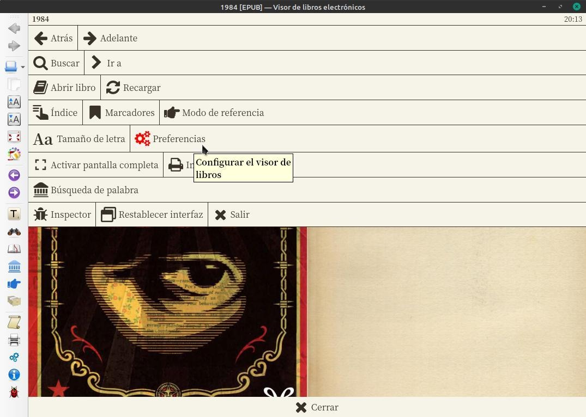
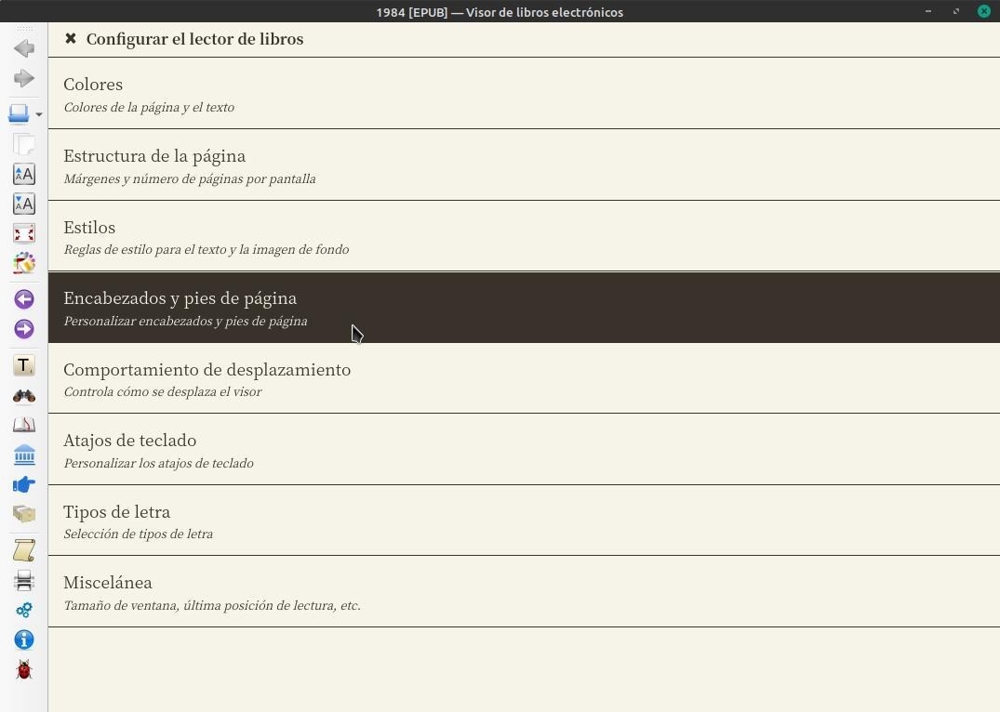
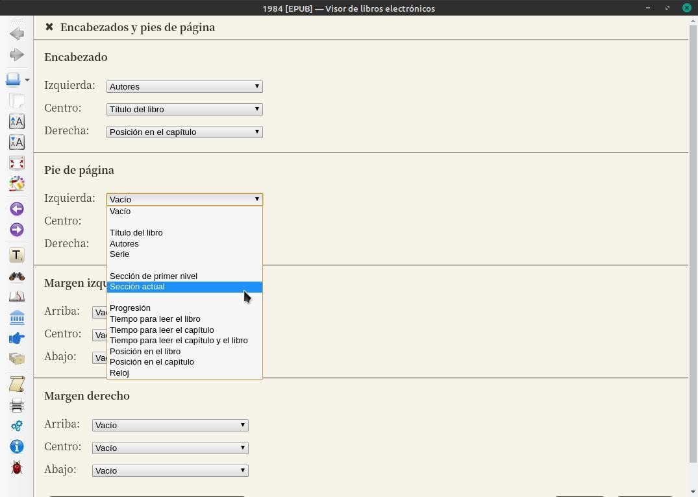

# Ver números de página en el visor de Calibre

:material-account: [Walter](https://t.me/Dunhill69){ target=_blank } · :material-link-variant: [Ver el original en Telegraph](https://telegra.ph/Ver-n%C3%BAmeros-de-p%C3%A1ginas-en-el-visor-de-Calibre-08-16){ target=_blank }
{ .tut-datos }

---

¿Como hago para que el lector de calibre me enumere las hojas y no me de el dato en porcentajes ?

Le damos click en el libro esperamos un momento a que se abra. Apretamos escape / Preferencias

Vamos a Encabezados y pie de página

Y elegimos un lugar para mostrar 'Posición en el libro'.

## [Volver al inicio](https://telegra.ph/Indice-Calibre-en-Espa%C3%B1ol-10-03)

 

 

---

[:material-arrow-left: Volver al índice](../../alfabetico.md) · [:fontawesome-brands-telegram: Preguntar en el grupo](https://t.me/calibreconfiguraciones){ target=_blank }
