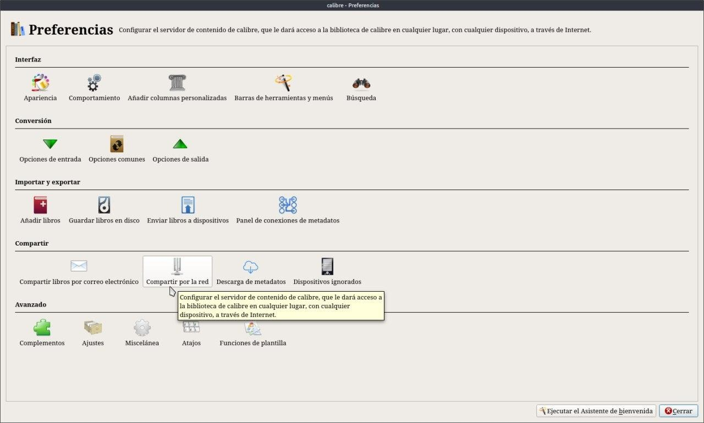
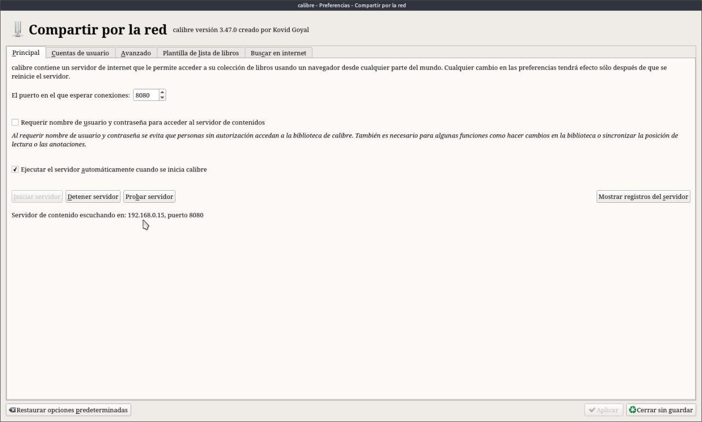
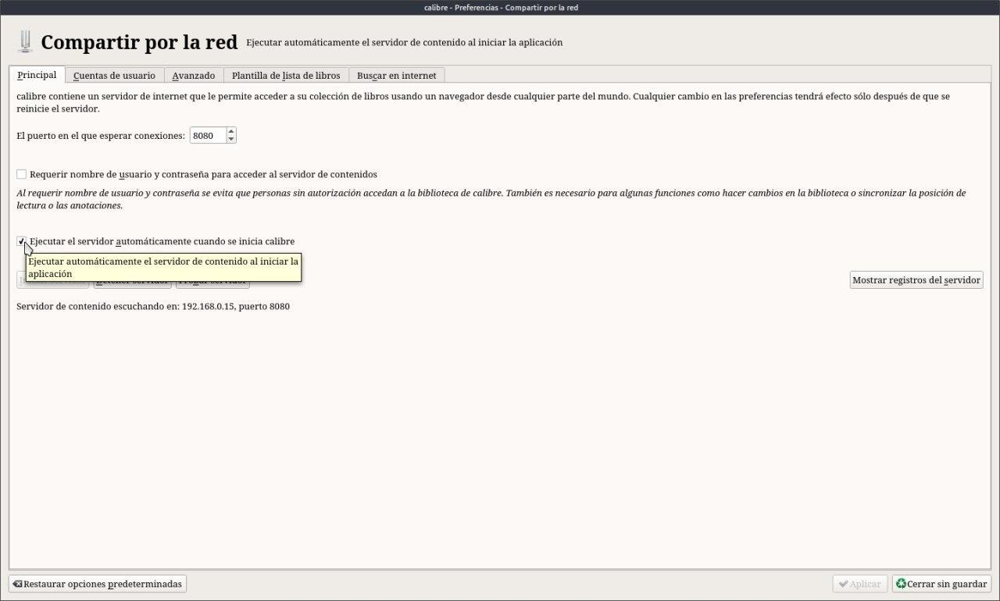
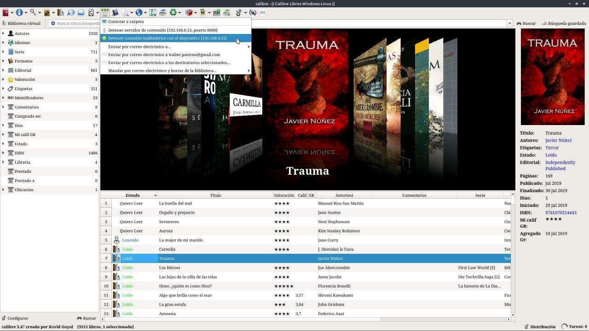
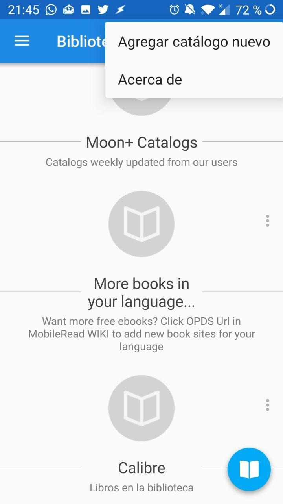
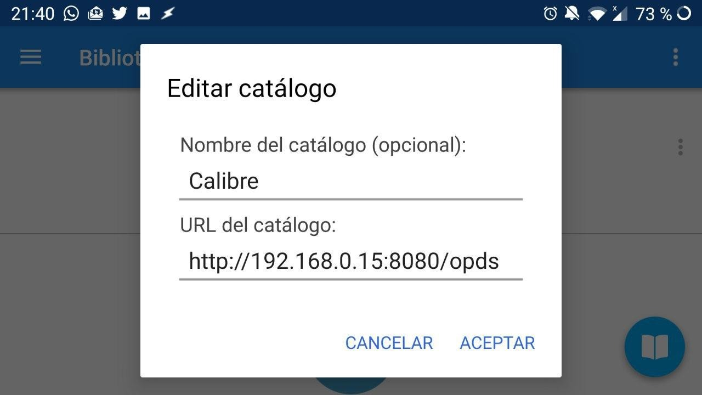
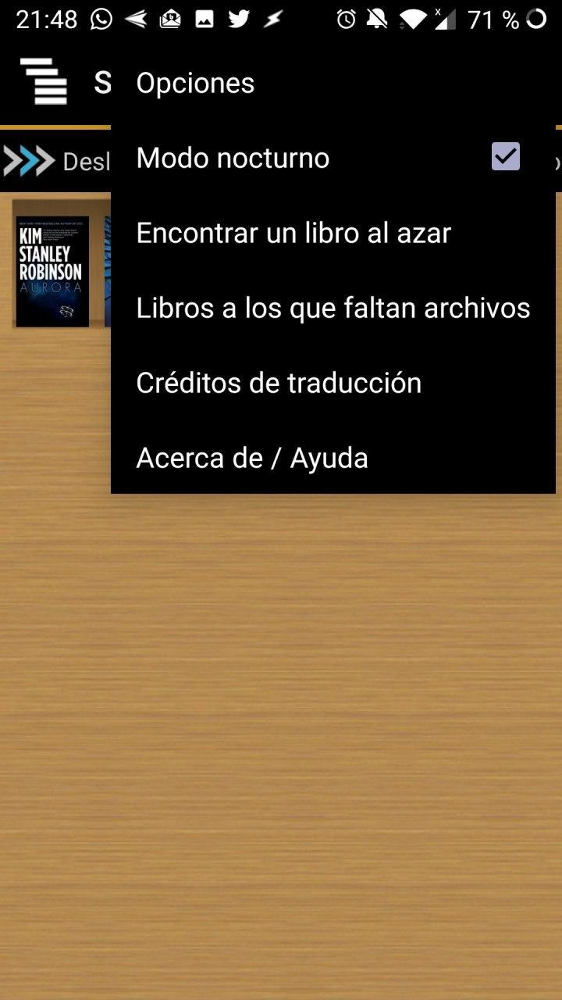
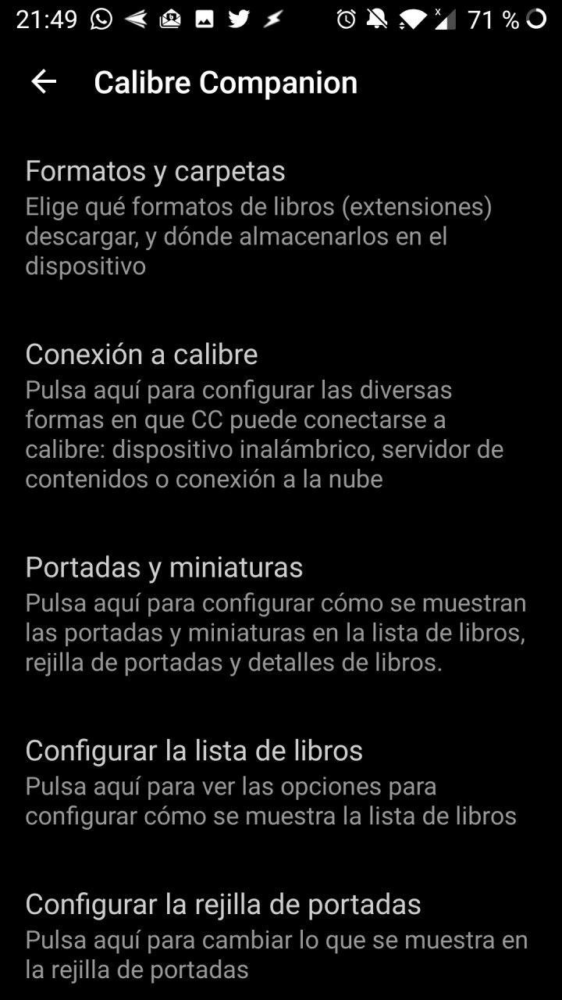
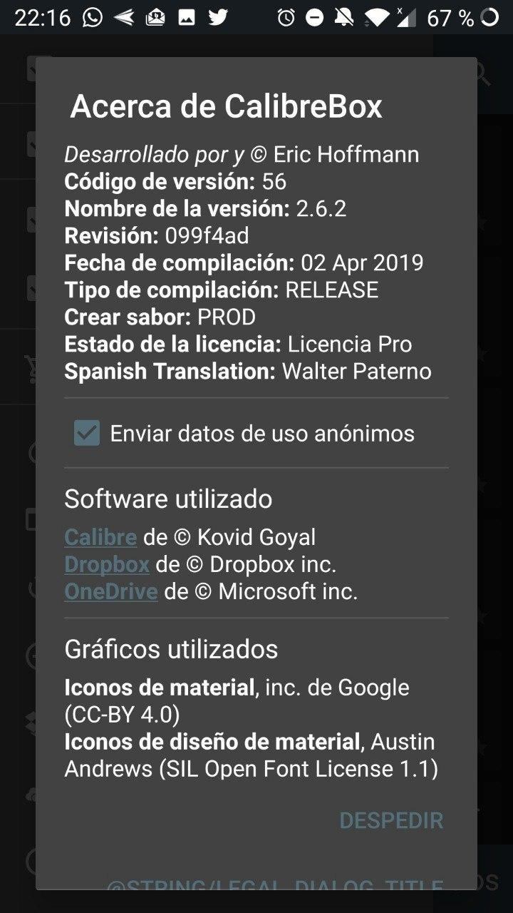

# Vincular Calibre con Android

:material-account: [Walter](https://t.me/Dunhill69){ target=_blank } · :material-link-variant: [Ver el original en Telegraph](https://telegra.ph/Vincular-Calibre-con-android-09-08){ target=_blank }
{ .tut-datos }

---

Como ver/vincular nuestra biblioteca de Calibre en el mobil. Para eso deberemos ir a Preferencias / Compartir por la Red

En la primer solapa donde esta el cursor en la imagen esa es la dirección de nuestra Biblioteca en Calibre, Cuidado: Cada instalación nueva esta dirección varia.

Tenemos que tener la precaución de marcar esta casilla para que cada vez que calibre este encendido se vincule. Si Calibre esta apagado no funciona Tanto para Calibrecompañon como para Moonreader.

En la Barra de herramientas esta el icono para conexiones especiales tiene tres circulitos que si esta apagado son azules y verde si esta conectado.

En Moonreader vamos a bibliotecas en los tres puntos de la mano superior derecha Agregar catálogo nuevo

Agregamos un nombre para reconocerlo y le agregamos la dirección. Hay un botón que dice Calibre IP que detecta la biblioteca automáticamente si no sabemos o no recordamos la dirección.

En CalibreCompanion, los mismos tres puntos de la mano superior derecha Opciones Conexión Calibre podemos elegir Servidor de contenidos, Dispositivo inalambrico y nube.

En Calibrebox, solo si tememos nuestra biblioteca en la nube, en este caso no hace falta tener encendida la maquina con Calibre. Elegimos nuestro servidor en la nube Dropbox o OneDrive agregamos nuestros correos y contraseñas para entrar y tendremos disponible nuestra biblioteca en todo momento. Que lo disfruten.

Calibrebox, traducido al español por un servidor😁😁

ir al mensaje: [https://t.me/calibreconfiguraciones/940](https://t.me/calibreconfiguraciones/940)

[https://telegra.ph/Vincular-Calibre-con-android-09-08](https://telegra.ph/Vincular-Calibre-con-android-09-08)

 

## [Volver al inicio](https://telegra.ph/Indice-Calibre-en-Espa%C3%B1ol-10-03)

 

---

[:material-arrow-left: Volver al índice](../../alfabetico.md) · [:fontawesome-brands-telegram: Preguntar en el grupo](https://t.me/calibreconfiguraciones){ target=_blank }
