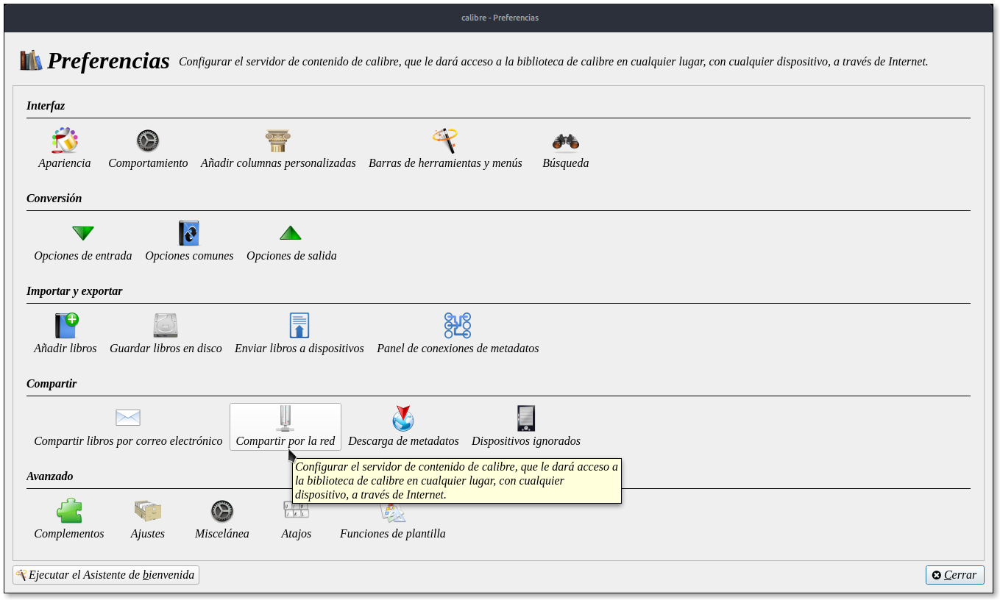
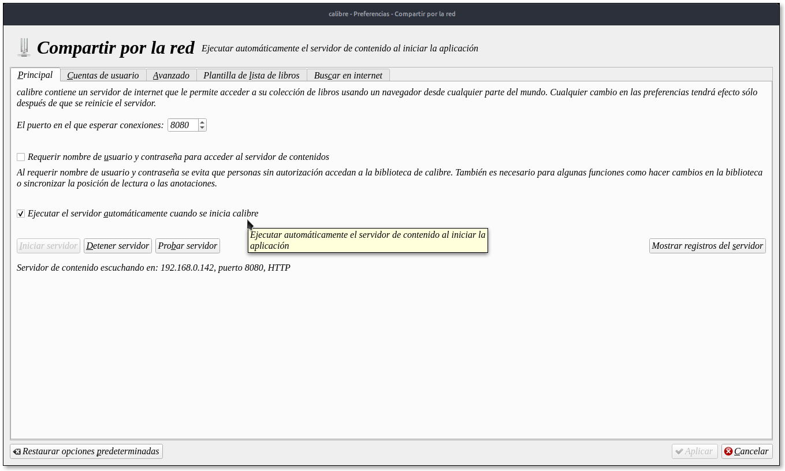
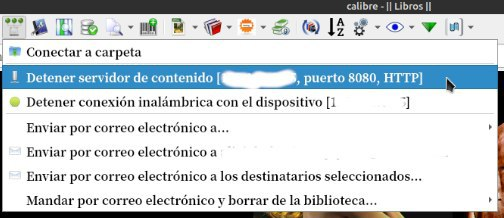
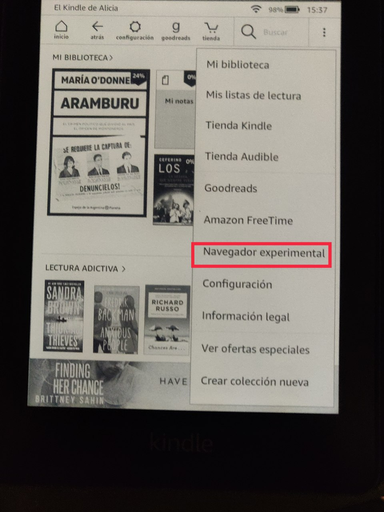
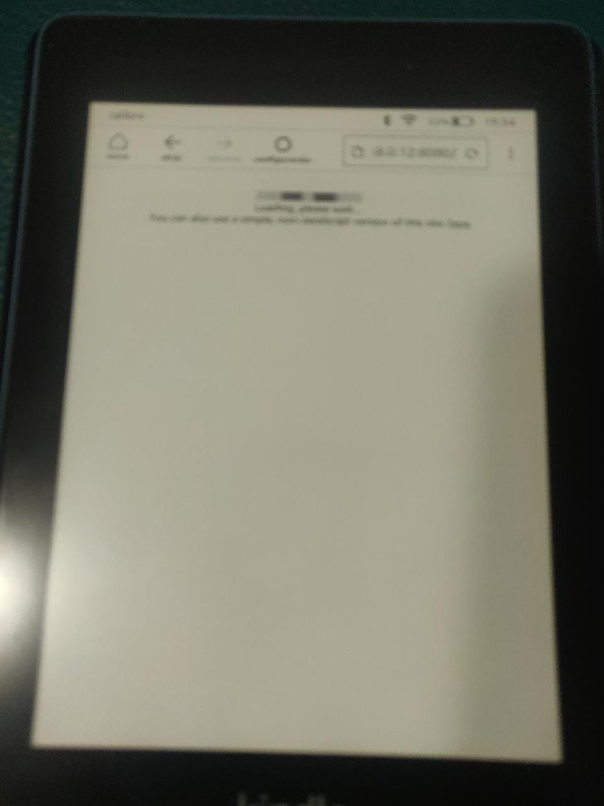
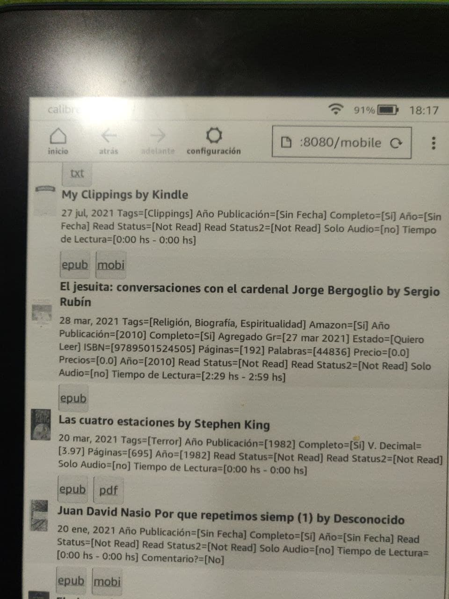
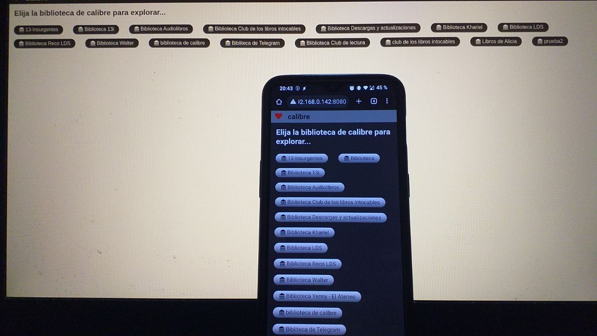

# Vincular Calibre con el navegador del Kindle u otro lector (parte 1)

:material-account: [Walter](https://t.me/Dunhill69){ target=_blank } · :material-link-variant: [Ver el original en Telegraph](https://telegra.ph/Vincular-Calibre-con-el-navegador-nativo-de-Kindle-o-cualquier-lector-que-tenga-navegador-Parte-1-08-06){ target=_blank }
{ .tut-datos }

---

Como lo puedo visualizar en Kindle ? A través del navegador experimental ?

[:material-play-circle: Ver video](https://telegra.ph/embed/telegram?url=https%3A%2F%2Ft.me%2Fcalibreconfiguraciones%2F12363){ target=_blank }

Calibre tiene un servidor  de contenidos, el mismo que ya hemos hablado en varios casos. Para activarlo vamos a Preferencias/compartir por internet

Si dejamos marcada esta opción se inicia al iniciar calibre

Otra manera es con el icono de los tres circulitos

Exacto en calibre activas servidor de contenidos y en el navegador experimental del kindle pones la dirección que te dice http://XXX.XXX.X.XX:8080 la misma dirección que has puesto en moon reader

El navegador experimental está en la mayoría de los Kindles desde el 2012, creo. Para usarlo con el servidor de calibre, agreguen /mobile al final de la dirección para que cargue la versión rápida. [https://t.me/calibreconfiguraciones/28767](https://t.me/calibreconfiguraciones/28767)

o sea [http://XXX.XXX.X.XX:8080/mobile](http://xxx.xxx.x.xx:8080/mobile)

Usando la misma red wifi y calibre debe estar encendido

El navegador experimental esta

[https://t.me/calibreconfiguraciones/28765](https://t.me/calibreconfiguraciones/28765)

Y ponemos esa dirección en nuestro navegador experimental y asi se conecta al kindle

Y asi se ve la bibliteca en este caso es una sola

Esto se puede usar en cualquier dispositivo que tenga navegador

 

## [Volver al inicio](https://telegra.ph/Indice-Calibre-en-Espa%C3%B1ol-10-03)

 

---

[:material-arrow-left: Volver al índice](../../alfabetico.md) · [:fontawesome-brands-telegram: Preguntar en el grupo](https://t.me/calibreconfiguraciones){ target=_blank }
