# Vincular Calibre con Goodreads

:material-account: [Walter](https://t.me/Dunhill69){ target=_blank } · :material-link-variant: [Ver el original en Telegraph](https://telegra.ph/Vincular-Calibre-con-Goodreads-09-08){ target=_blank }
{ .tut-datos }

---

Como tener sincronizado nuestro calibre con nuestra cuenta de goodreads.

Tendremos que ante todo configurar calibre para que sea compatible con goodreads, agregándole algunas columnas personalizadas.

**Para Estado:**

Creamos una que el nombre sea goodreadstags , encabezado sea Estado y tipo de columna Texto, columna mostrada en el explorador de etiquetas.

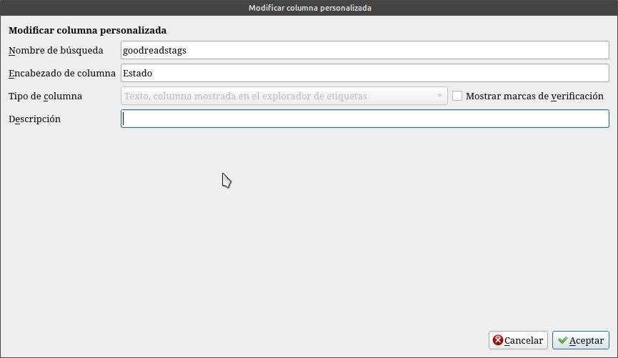

**Para Finalizado** (para fecha de termino de lectura.)

Creamos una que el nombre sea dateendded, el encabezado Finalizado y tipo de columna fecha.

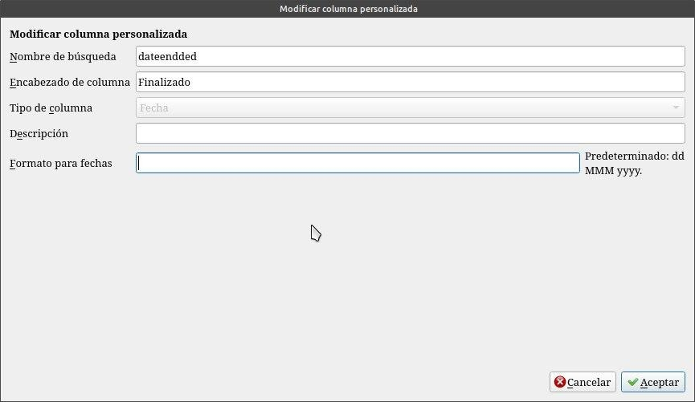

**Para Iniciado** (para fecha de inicio de lectura)

Creamos una que el nombre sea goodreadsstarted1, el encabezado Iniciado y tipo de columna fecha.

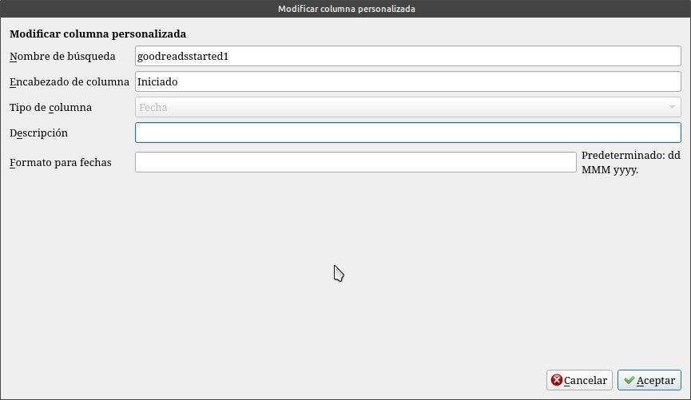

Para saber la fecha que agregamos el libro a goodreads

Creamos una que el nombre sea goodreadsdateadded el encabezado Agregado Gr y tipo de columna fecha.

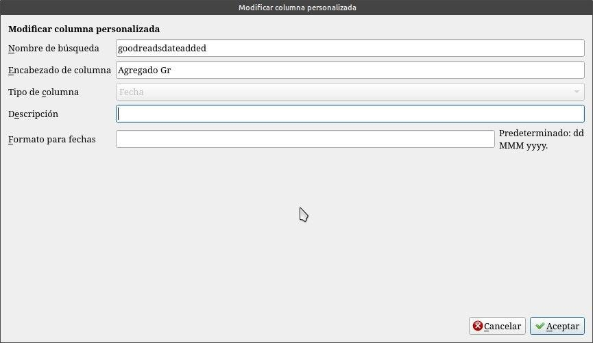

Para poner mi calificación en goodreads desde o a calibre

Creamos una que el nombre sea goodreadsranting , el encabezado Mi calif GR, tipo de columna valoraciones, representadas con estrellas y marcamos permitir medias estrellas.

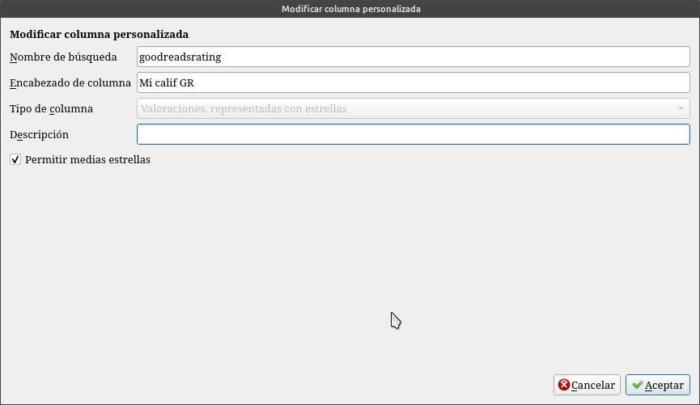

Para tener la calificación de goodreads

Creamos una que el nombre sea calificación , el encabezado Calif. GR, tipo de columna números con decimales.

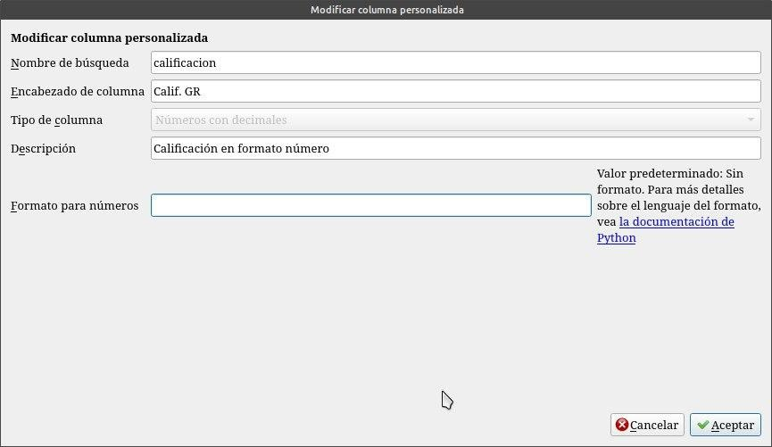

Terminada la creación de las columnas personalizadas damos en aceptar y se nos va a reiniciar Calibre, para que haga efecto estos cambios, las columnas aparecerán en las ultimas posiciones, deberemos posecionarlas, apretando con el mouse sobre la columna y desplazarla a sus lugares a elección.

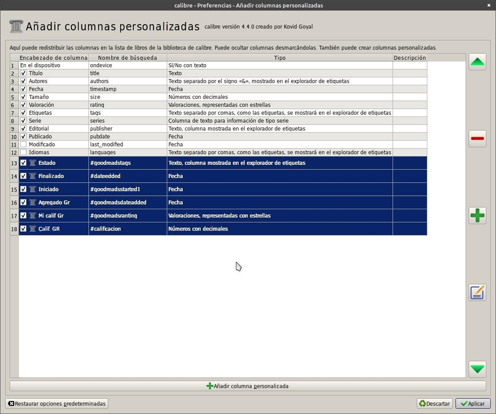

Ahora instalamos el plugin Goodreads sync que les dejo traducido al español, este lo descargamos en el escritorio.

Y lo instalamos tocando en Preferencias/Complementos/Cargar complemento desde un archivo.

Lo bueno seria tener también instalado el plugin Goodreads para descargar metadatos ya que este vincula el libro con Goodreads. Una vez instalados los dos plugin se reinicia Calibre y en la barra de herramienta nos aparecerá el icono del Goodreads sync ( ya falta poco deberemos configurar el plugin)

***ir la plugin Goodreads Sync*** o mejor bajarlo desde calibre para tener la ultima versión, que tambien viene traducido al español por un servidor [https://t.me/calibreconfiguraciones/2949](https://t.me/calibreconfiguraciones/2949)

***ir la plugin Goodreads*** para los metadatos o mejor descargarlo desde calibre: [https://t.me/calibreconfiguraciones/2950](https://t.me/calibreconfiguraciones/2950)

 

Una vez reiniciado Calibre nos sale el icono en la barra de herramientas

Hacemos click en el icono y tocamos personalizar complemento.

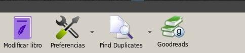

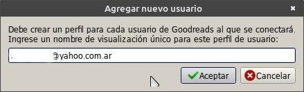

En ese campo ponemos la dirección de correo con la cual entramos a Goodreads se nos abre una pantalla donde tenemos que autorizar el plugin con Goodreads,solamente con tocar el botón que dice Autorizar se nos abre en el navegador nuestra sección de Goodreads.  Y automáticamente se nos agregan nuestros estantes de Goodreads al plugin.

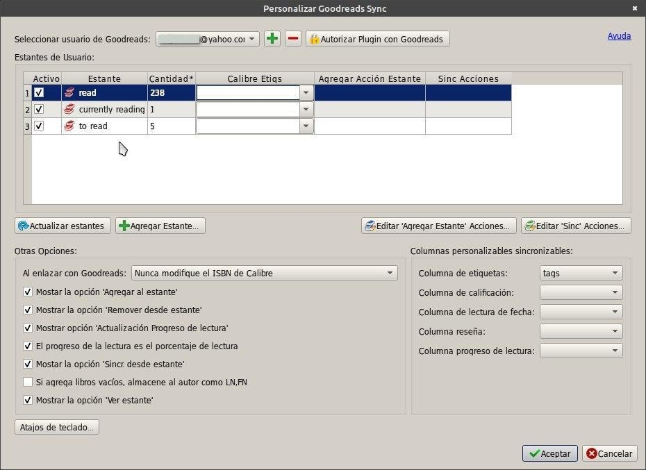

Les dejo acá abajo lo que tienen que poner en cada estante todo con click las configuraciones para los estantes de

Quiero leer (to read)

Acciones para agregar al estante:

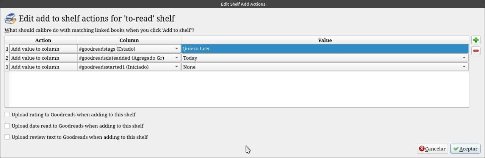

Acciones para sincronizar estante:

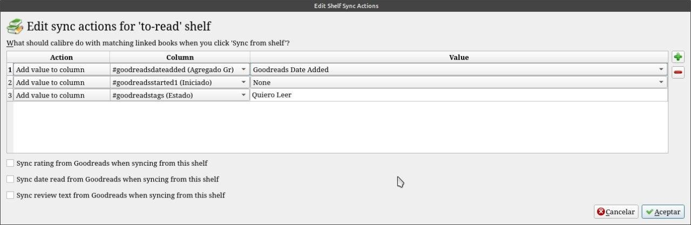

Leyendo (currently reading)

Acciones para agregar al estante:

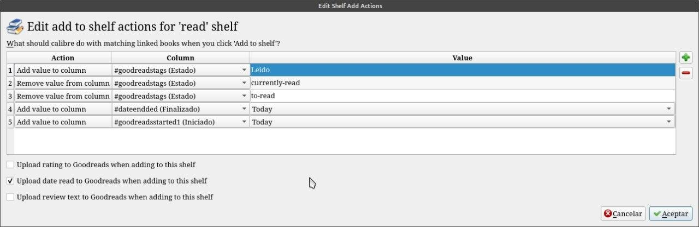

Acciones para sincronizar estante:

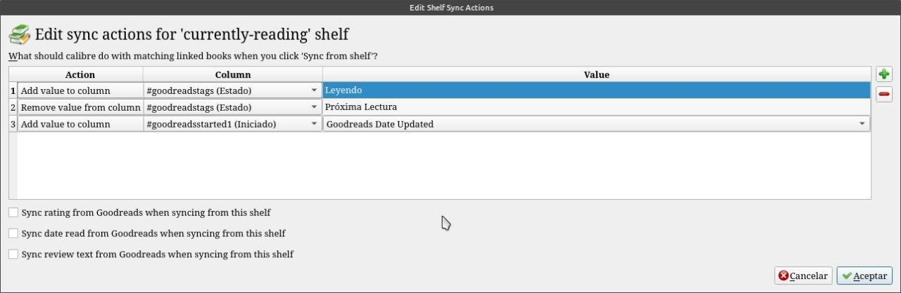

Leído (read)

Acciones para agregar al estante:

Acciones para sincronizar estante:

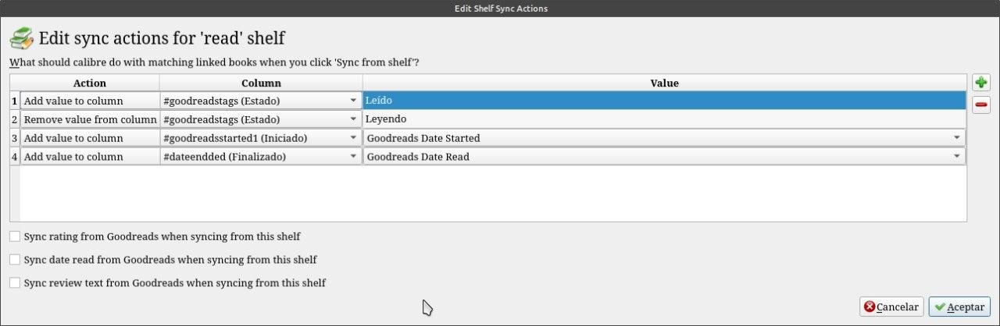

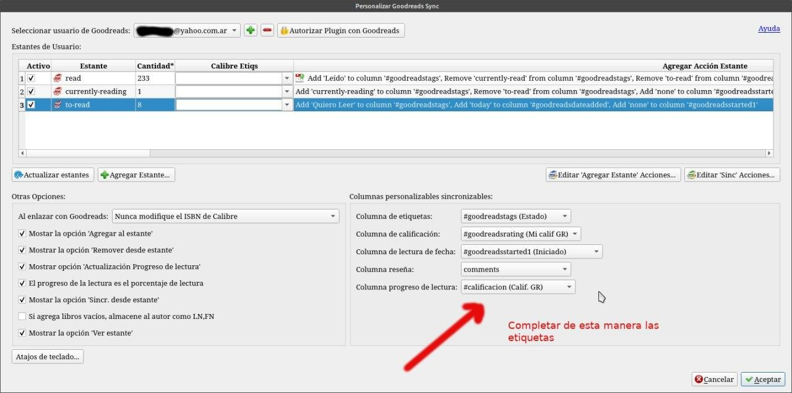

Así queda vinculado Calibre con nuestra cuenta goodreads. Adelante, mis valientes !!!!

ir al mensaje: [https://t.me/calibreconfiguraciones/2940](https://t.me/calibreconfiguraciones/2940)

Si queremos traer los comentarios que hacemos de los libros de goodreads a nuestra biblioteca de calibre.

Primero debemos crear una columna personalizada por ejemplo "Mis comentarios" para que no interfiera con la que viene por defecto con calibre. Con estas especificaciones:

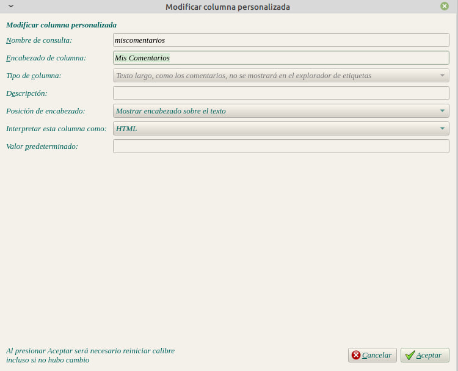

En la configuración del plugin goodreads sync completamos este campo seleccionando nuestra columna de "Mis comentarios"

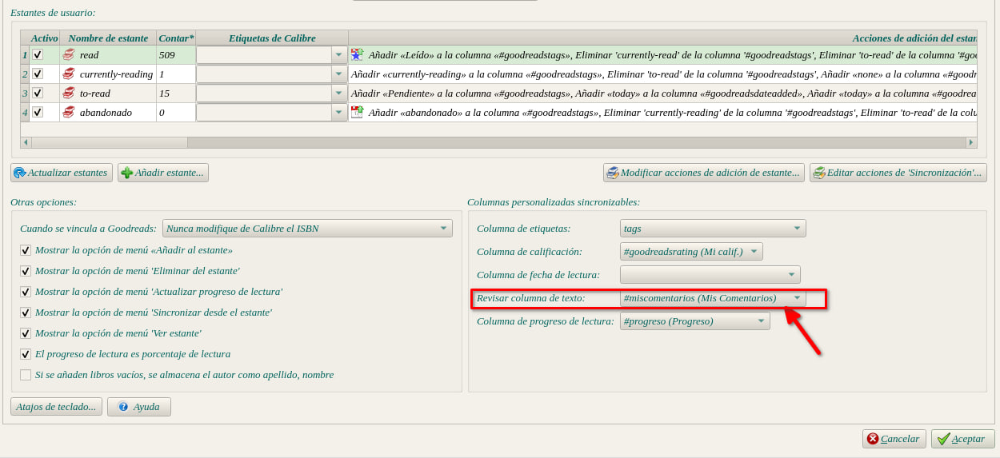

Y cuando sincronicemos nuestro estante de libro leído.

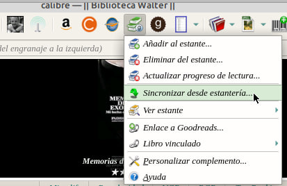

Donde hemos dejado el comentario del libro que hicimos en goodreads lo veremos en calibre.

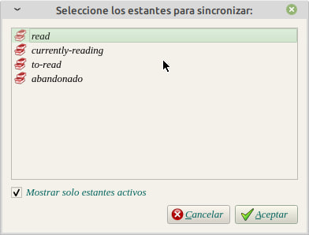

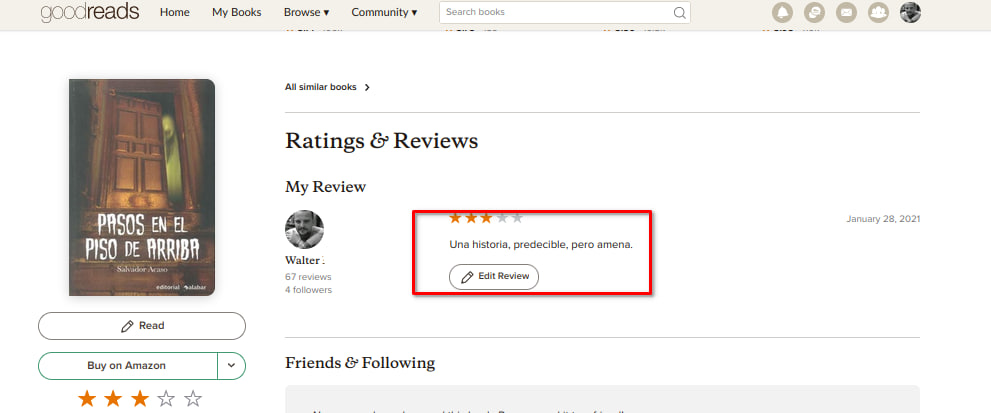

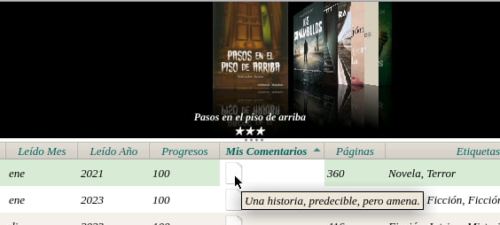

Ir al mensaje: [https://t.me/calibreconfiguraciones/112333/165025](https://t.me/calibreconfiguraciones/112333/165025)

## [Volver al inicio](https://telegra.ph/Indice-Calibre-en-Espa%C3%B1ol-10-03)

 

 

---

[:material-arrow-left: Volver al índice](../../alfabetico.md) · [:fontawesome-brands-telegram: Preguntar en el grupo](https://t.me/calibreconfiguraciones){ target=_blank }
