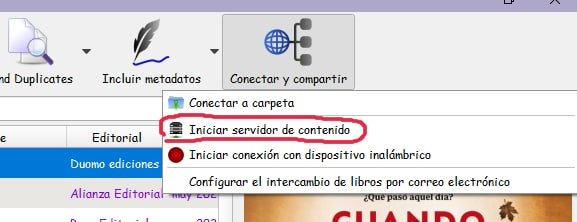
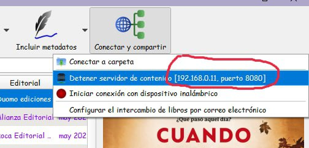
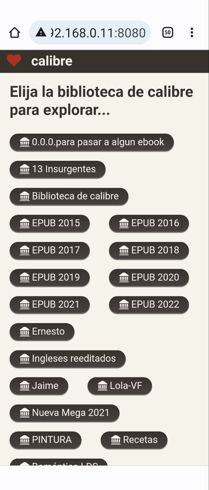
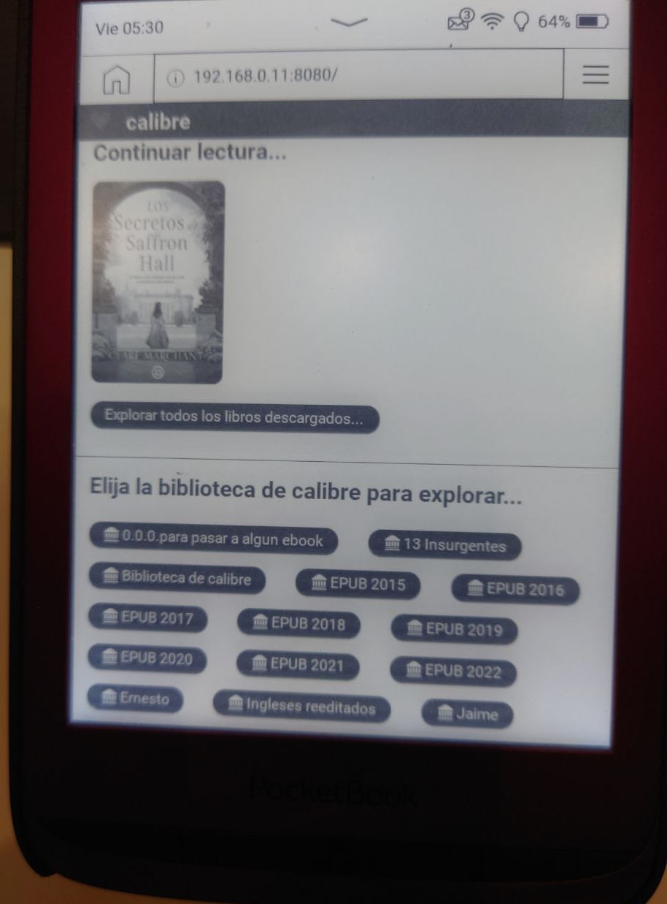

# Vincular Calibre con un PocketBook

:material-account: [Walter](https://t.me/Dunhill69){ target=_blank } · :material-link-variant: [Ver el original en Telegraph](https://telegra.ph/Vincular-Calibre-con-un-pocketbook-08-06){ target=_blank }
{ .tut-datos }

---

Explicado por Janes\_morris

Yo no tengo kobo, tengo pocketbook, pero me parece que este tuto servirá igual para cualquier ereader que tenga navegador, lo aprendí ayer y va fenomenal

Para conectar móvil, tablet, pocketbook con calibre:

- Inicio el servidor de contenido en calibre

Vuelvo a clicar y ya me sale: 192.168.0.11:8080

- En el navegador de android se pone 192.168.0.11:8080 e intro

- En el navegador del pocket :

192.168.0.11:8080/mobile , o mejor 192.168.0.11:8080/ e intro

(de las dos maneras se muestran las biblios de calibre, pero en la primera solo se muestra una y abajo del todo la opción de cambiar.

De la segunda manera salen todas a la vez como en el movil)

(despues de poner el número la primera vez, tocando en las 3 rayitas de arriba a la derecha, clic en historial —\>clic en calibre y ya se muestran solas todas las biblios)

- Elijo la biblio que quiera, busco el libro que quiera y lo descargo, toco en la portadita y debajo del título me da la opción de leer o descargar, toco encima se descarga, vuelvo a tocar y ya me sale el libro para leer, automaticamente se pasa a mi biblio del pocket.

En el momento en que cierro el calibre y por tanto no tengo abierto el servidor del contenido en calibre, o si me alejo del wifi ya no va a funcionar

El wifi tiene que ser el mismo el del router donde tengo el ordenador en el que tengo calibre y el del movil y/o el pocketbook

este sistema es para descargar directamente de mi calibre los libros que quiera en el movil, table o pocketbook, pero siempre que tenga abierto calibre con el servidor de contenido, y que me llegue la señal del wifi común para el ordenador del router, el movil, tablet y pocketbook

 

RESUMEN:

- Inicio el servidor de contenido en calibre

-en el navegador de mi movil pongo el numero que me sale en calibre al iniciar el servidor, en mi caso es este : 192.168.0.11:8080 pero cada uno tendrá el suyo

-entro en el navegador de mi ereader y arriba del todo pongo 192.168.0.11:8080/mobile , o mejor

192.168.0.11:8080/

-me conecta sin mas nada con todas mis biblios calibre, elijo la que quiera y los libros que quiera y descargo en el ebook

-en el momento en que cierre calibre o si me voy de casa y por tanto ya no tengo ni el wifi del router, ni el servidor de calibre ya no va a funcionar.

-o sea, esto es para descargar directamente del calibre en mi ereader (otra forma distinta de la nube de pocketbook cloud). O si alguien llega a mi casa y con su navegador le doy acceso a mi biblioteca calibre.

 

Adjunto el word (mi chuleta) con todo esto por si alguien se lo quiere descargar

ir al mensaje:

[:material-play-circle: Ver video](https://telegra.ph/embed/telegram?url=https%3A%2F%2Ft.me%2Fcalibreconfiguraciones%2F88897){ target=_blank }

 

---

[:material-arrow-left: Volver al índice](../../alfabetico.md) · [:fontawesome-brands-telegram: Preguntar en el grupo](https://t.me/calibreconfiguraciones){ target=_blank }
