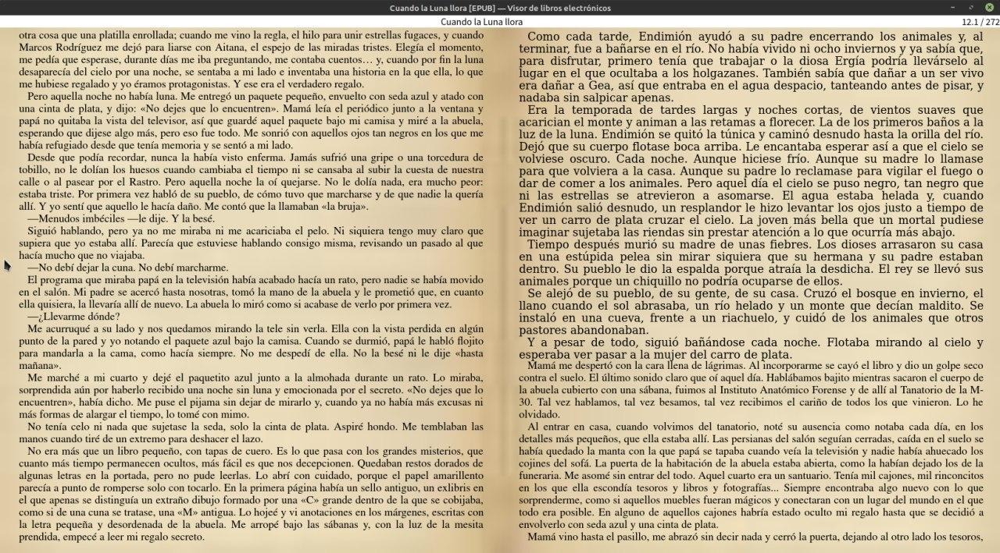
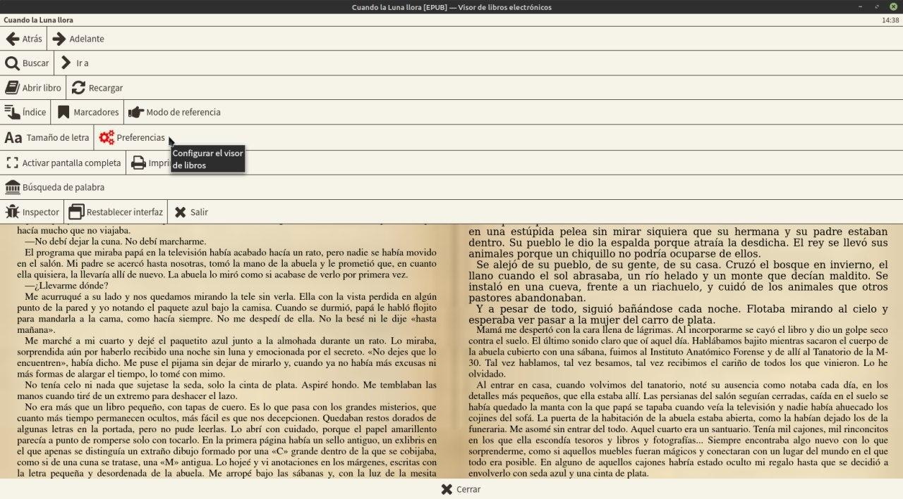
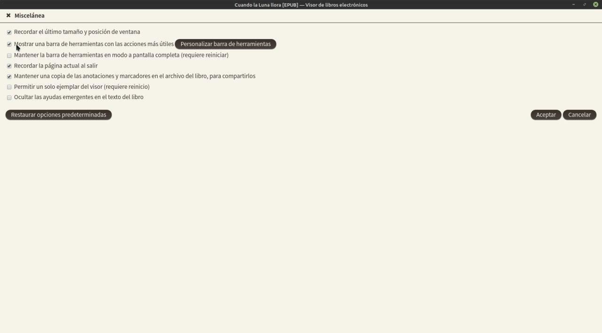
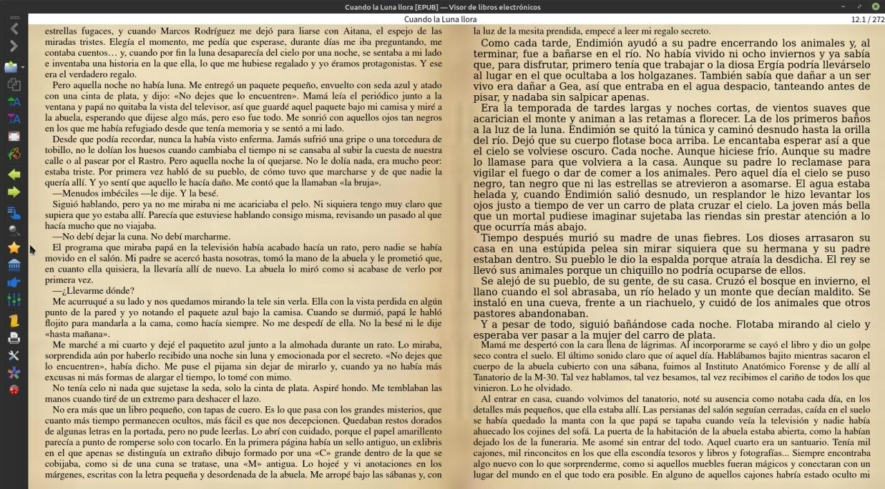

# Visor de libros - poner barra lateral (como en Calibre 3)

:material-account: [Walter](https://t.me/Dunhill69){ target=_blank } · :material-link-variant: [Ver el original en Telegraph](https://telegra.ph/Visor-de-libros---Poner-barra-lateral--como-versi%C3%B3n-3-de-Calibre-09-08){ target=_blank }
{ .tut-datos }

---

Así vemos el nuevo visor de libros, (sin el efecto de hoja vieja) No se ve la barra lateral. Para que aparezca tocamos esc.

Nos aparece un panel de opciones de ajustes, tocamos Preferencias.

Nos vamos a Miselaneas y marcamos la segunda opción, se cierra solo el visor, deberemos hacer click en la portada del libro para que se abra.

Y ya tendremos la barra lateral como el formato viejo, visible nuevamente.

ir al mensaje: [https://t.me/calibreconfiguraciones/10085](https://t.me/calibreconfiguraciones/10085)

[https://telegra.ph/Visor-de-libros---Poner-barra-lateral--como-versi%C3%B3n-3-de-Calibre-09-08](https://telegra.ph/Visor-de-libros---Poner-barra-lateral--como-versi%C3%B3n-3-de-Calibre-09-08)

## [Volver al inicio](https://telegra.ph/Indice-Calibre-en-Espa%C3%B1ol-10-03)

 

---

[:material-arrow-left: Volver al índice](../../alfabetico.md) · [:fontawesome-brands-telegram: Preguntar en el grupo](https://t.me/calibreconfiguraciones){ target=_blank }
